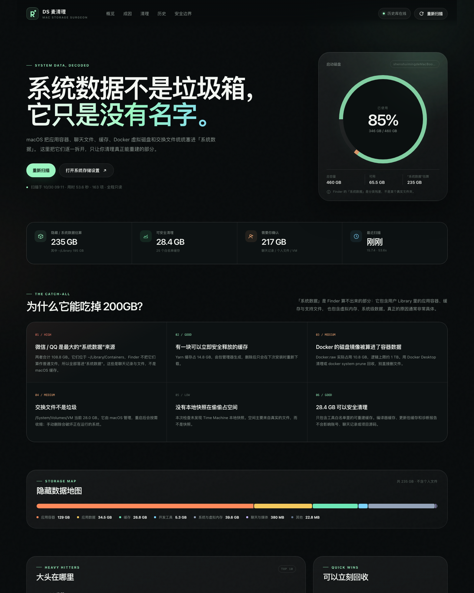
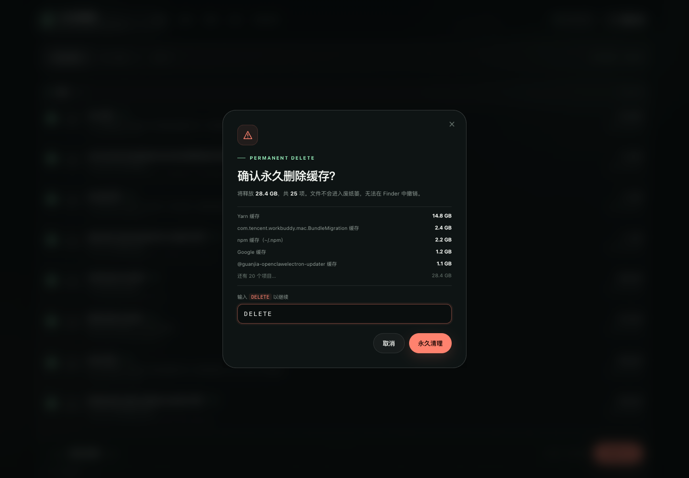
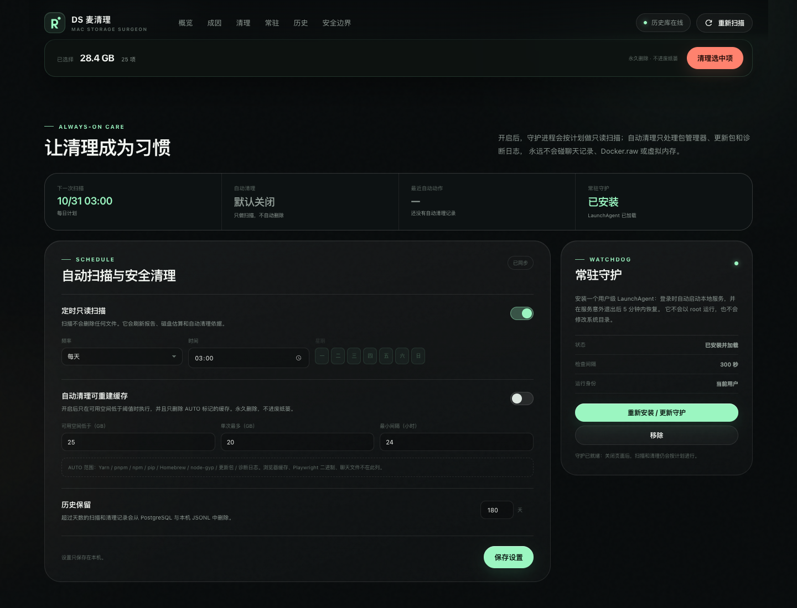

# DS 麦清理 · DS Mac Cleaner

> 把 macOS 的「系统数据」拆开看清楚，只清理真正可以重建的缓存。

一台 512GB 的 Mac，Finder 显示「系统数据」吃了 200GB——这通常不是 macOS 本体，而是
`~/Library` 里的应用容器、聊天文件、缓存、Docker 虚拟磁盘和交换文件被归进了同一个分类。
本项目是一个本地运行的扫描器 + 安全清理器 + Web 控制台，用数据解释每一 GB 从哪来。

**本机实测（2026-10-30）：** 启动盘已用 345.7 GiB / 460.4 GiB，可解释隐藏数据约 **235 GB**，
其中 `~/Library` **195 GB**；可安全清理的缓存 **28.4 GB**；QQ + 微信 **108.8 GB**。
详细解剖见 [analysis/system-data-report.md](analysis/system-data-report.md)。



## 它解决什么问题

Finder 的「系统数据」不是真实目录，而是 macOS 存储分类的残差。它常包含：

- 沙盒应用容器：微信、QQ、钉钉等，聊天文件就在这里；
- 应用支持：Chrome 配置、编辑器扩展、Steam 下载；
- 可重建缓存：Yarn / npm / Homebrew / 浏览器 / 更新包；
- Docker 稀疏磁盘、VM swap、系统临时文件；
- 本地 Time Machine 快照（如果有）。

DS Mac Cleaner 会：**逐项测量 → 标记来源 → 给出安全等级 → 只允许白名单缓存被删除**。
它不会“猜测”删除，不会碰聊天记录，不会把 Docker.raw 当成 1TB 垃圾。

## 功能

- **只读扫描**：`du` + `df` + `tmutil`，不发网络请求，不上传任何数据。
- **可视化**：磁盘环、隐藏数据分布、Top 10 大头、可回收项、原因解释。
- **安全清理**：默认选择可重建缓存；删除前输入 `DELETE`；服务端二次校验路径白名单、符号链接、挂载点。
- **历史记录**：扫描与清理写入 Docker Compose 启动的 PostgreSQL；Docker 未启动时自动降级到本机 JSONL。
- **macOS 启动器**：构建 `.app` 安装到 `/Applications`，出现在启动台；点击启动本地服务并打开浏览器。
- **常态化守护**：用户级 LaunchAgent 登录自启，每 5 分钟确认服务存活；关闭页面也会继续按计划工作。
- **定时扫描 + 可选自动清理**：每日/每周计划；自动清理只处理 `AUTO` 标记的可重建缓存，默认关闭。
- **中文界面 / 离线可用**：无 CDN、无遥测、无外部字体。

## 本机扫描结果（摘要）

| 项目 | 占用 | 处理建议 |
|---|---:|---|
| QQ 容器 | 59.2 GB | 在 QQ「设置 → 存储管理」清理，勿删 `nt_db` |
| 微信容器 | 49.6 GB | 微信「设置 → 存储空间」按类型清理 |
| VM swap | 28.0 GB | 重启由 macOS 回收，勿手动删 |
| Yarn 缓存 | 14.8 GB | ✅ 可安全清理 |
| Docker.raw 实际占用 | 10.8 GB | `docker system prune`，勿删文件 |
| Google 应用数据 | 8.2 GB | 持久数据，需人工判断 |
| Downloads | 10.9 GB | 个人文件，自行整理 |
| 可安全清理合计 | **28.4 GB** | 25 个白名单缓存项 |



## 常态化清理

不是“打开一次扫一次”，而是把它作为常驻工具：



- **默认计划**：每天 03:00 做一次只读扫描。下一次时间在「常驻」页可见。
- **常驻守护**：安装用户级 LaunchAgent，登录时启动服务；之后每 300 秒检查一次，服务意外退出会自动拉起。
- **自动清理默认关闭**。开启后，只有同时满足以下条件才会执行：
  1. 可用空间低于你设置的阈值（例如 25GB）；
  2. 距离上次自动清理超过最小间隔（例如 24 小时）；
  3. 项目带 `AUTO` 标记，且单次总量不超过你设置的上限。

`AUTO` 范围刻意收窄：Yarn / pnpm / npm / pip / Homebrew / node-gyp / 更新包 / 诊断日志。
浏览器缓存、Playwright 二进制、Xcode DerivedData、聊天记录、Docker.raw、VM swap **永远不会被自动删除**。
自动清理结果也会写入历史，带 `AUTO` 标签。

开关和计划都在 **「常驻」** 页面；安装 App 时默认安装守护，也可以手动管理：

```bash
./scripts/install-agent.sh
./scripts/uninstall-agent.sh
launchctl print gui/$(id -u)/com.deepseek.dsmaccleaner.agent
```

## 快速开始

### 依赖

- macOS 12+（本机 macOS 15.7.4）
- Python 3.9+（系统自带即可）
- Docker Desktop（可选，仅历史数据库需要）
- 只有构建图标时需要 Pillow；`setup.sh` 会安装到项目虚拟环境

### 1. 初始化

```bash
cd ds-mac-cleaner
./scripts/setup.sh
```

它会：

1. 创建 `.venv` 并安装 `psycopg2-binary` 与 Pillow；
2. 复制 `.env.example` 为 `.env`；
3. 如果 Docker 正在运行，执行 `docker compose up -d db` 启动历史库。

### 2. 启动 Web

```bash
./scripts/start-server.sh
# 打开 http://127.0.0.1:8787
```

首次扫描约 30–60 秒（本机 53.6 秒）。扫描是只读的。

### 3. 安装到启动台

```bash
./scripts/install-app.sh
```

会把 `DS Mac Cleaner.app` 复制到 `/Applications`，注册 LaunchServices，并安装常驻 LaunchAgent。
之后在**启动台**搜索「DS 麦清理」或「DS Mac Cleaner」即可打开。
如果 `/Applications` 不可写，会自动退回到 `~/Applications`。

不需要守护时：

```bash
DSMC_SKIP_AGENT=1 ./scripts/install-app.sh
```

App 本身是一个轻量启动器：启动项目里的本地 Python 服务，然后打开 `http://127.0.0.1:8787`。
项目目录不要删除或移动，否则启动器会失效（重新运行 `install-app.sh` 可修复路径）。

### 不想用 App？

```bash
# 前台运行
./scripts/start-server.sh

# 数据库
docker compose up -d db
docker compose --profile tools up -d adminer   # 可选，http://127.0.0.1:8088
```

## 安全模型

这是整个项目的核心，不是装饰。

1. **扫描零删除**：扫描器只有 `du`、`df`、`tmutil`、`sysctl` 等只读调用。
2. **服务端不信任客户端路径**：前端只提交 `item_id`；服务端从持久化的扫描报告里取路径，重新校验。
3. **删除白名单**：只允许位于以下根目录内的子路径：
   - `~/Library/Caches`
   - `~/Library/Logs/DiagnosticReports`
   - `~/Library/Developer/Xcode/DerivedData`
   - `~/Library/Developer/CoreSimulator/Caches`
   - `~/.npm/_cacache`
4. **二次防御**：拒绝符号链接、挂载点、根目录本身、真实路径逃逸；部分删除失败会记录错误，不谎报释放。
5. **确认词**：手动 HTTP 清理请求必须带随机本地会话令牌，并且 body 中 `confirm` 必须等于 `DELETE`。
6. **自动清理的额外闸门**：必须显式开启；仅 `AUTO` 项；有磁盘阈值、单次上限、最小间隔；默认关闭。
7. **历史留痕**：每次扫描/清理写入 PostgreSQL；Docker 不可用时写 `.runtime/history.jsonl`。
8. **保留期**：超过设定天数的扫描/清理记录会从 PostgreSQL 和 JSONL 中删除。

聊天记录、Docker.raw、VM swap、Downloads、废纸篓等**永远不会进入可勾选状态**，只做报告与 Finder 定位。

## 架构

```text
macOS App (Launchpad)
   │  open http://127.0.0.1:8787
   ▼
Python stdlib HTTP server (server/app.py)
   ├── scanner.py    只读测量 → 报告 JSON
   ├── catalog.py    分类 / 风险 / 白名单 / AUTO 标记
   ├── cleanup.py    服务端二次校验 + 删除
   ├── automation.py 定时扫描 + 阈值触发的自动清理
   ├── settings.py   设置 + 自动化状态持久化
   ├── agent.py      用户级 LaunchAgent 安装/状态
   ├── history.py    PostgreSQL（psycopg2） + JSONL fallback
   └── web/          原生 HTML/CSS/JS，无构建步骤
          │
          ▼
Docker Compose: postgres:16-alpine (127.0.0.1:55432)
```

目录：

```text
ds-mac-cleaner/
├── analysis/system-data-report.md   # 本机解剖报告
├── db/init.sql                      # PostgreSQL schema
├── docker-compose.yml               # 历史库 + 可选 Adminer
├── launcher/                        # .app 启动脚本模板
├── scripts/                         # setup / start / build / install / icon
├── server/                          # Python 后端（扫描/清理/自动化/守护）
├── tests/                           # 安全、调度、自动清理测试
├── scripts/install-agent.sh         # 常驻守护安装
├── scripts/agent-runner.sh          # LaunchAgent 每 5 分钟探活
├── web/                             # 单页 Web UI
├── dist/DS Mac Cleaner.app          # 构建产物（安装前）
└── docs/                            # 界面截图
```

## 数据库

`docker compose up -d db` 启动 PostgreSQL 16：

| 配置 | 默认值 |
|---|---|
| 地址 | `127.0.0.1:55432` |
| 数据库 | `dsmac` |
| 用户 / 密码 | `dsmac` / `dsmac_local_dev` |
| 数据卷 | `ds-mac-cleaner-db-data` |

表：

- `scans`：每次扫描的磁盘、估算、完整 JSON 报告、`trigger`（manual/auto）；
- `cleanup_runs`：清理项、请求字节、实际释放、错误、dry-run、`trigger`（manual/auto）。

历史保留天数在「常驻」页设置；调度器每天自动执行一次 prune，同时清理 PostgreSQL 与本地 JSONL。

在 UI 里点「历史库离线」或「启动历史数据库」，会执行 `docker compose up -d db` 并等待就绪。
Adminer 可选：

```bash
docker compose --profile tools up -d adminer
open http://127.0.0.1:8088
# System: PostgreSQL, Server: db, Username: dsmac, Password: dsmac_local_dev, DB: dsmac
```

## API 摘要

服务只绑定 `127.0.0.1`，所有 POST 需要 `X-DSMC-Token`。

| 方法 | 路径 | 说明 |
|---|---|---|
| GET | `/api/health` | 版本、DB 状态、Docker 可用性 |
| GET | `/api/latest` | 最近一次扫描报告 |
| POST | `/api/scans` | 启动扫描任务，返回 `task.id` |
| GET | `/api/tasks/{id}` | 轮询任务进度/结果 |
| POST | `/api/cleanups` | 清理指定 `item_ids`，需 `confirm: "DELETE"` |
| GET | `/api/automation` | 设置、下次扫描、自动清理状态、守护状态 |
| POST | `/api/settings` | 保存扫描/自动清理/历史保留设置 |
| POST | `/api/agent/install` | 安装并加载 LaunchAgent |
| POST | `/api/agent/uninstall` | 移除 LaunchAgent |
| GET | `/api/history?limit=30` | PostgreSQL / 本地历史 |
| POST | `/api/db/start` | 启动 Compose 历史库 |
| POST | `/api/reveal` | 在 Finder 中显示报告中的路径 |
| GET | `/api/scans/{id}/export` | 下载 JSON 报告 |

示例：

```bash
TOKEN=$(curl -s http://127.0.0.1:8787/ | sed -n 's/.*name="dsmc-token" content="\([^"]*\)".*/\1/p')
curl -s -X POST -H "X-DSMC-Token: $TOKEN" -H 'Content-Type: application/json' \
  -d '{}' http://127.0.0.1:8787/api/scans
```

## 开发与测试

```bash
# 单元测试（不访问真实系统目录）
PYTHONPYCACHEPREFIX="$PWD/.pycache" .venv/bin/python -m unittest discover -s tests -v

# 构建 .app
./scripts/build-app.sh

# 安装并打开
./scripts/install-app.sh
```

测试覆盖：只读扫描、路径白名单、符号链接/挂载点拒绝、自动清理候选筛选、
每日/每周调度、设置边界、历史保留。当前共 21 个单元测试：

```bash
make test
```

代码刻意保持**标准库优先**：

- 后端无 Web 框架；`http.server.ThreadingHTTPServer` 足够本地单用户场景；
- 前端无构建步骤，直接读 `web/`；
- 运行时只有 PostgreSQL 驱动是外部依赖；缺失时自动降级到本地 JSONL。Pillow 只用于构建 App 图标。

## 常见问题

**扫描很慢？**  
首次要遍历 `~/Library` 的 195 GB，本机约 54 秒。后续扫描仍会重新测量，因为缓存会变化。
受 TCC 保护的应用容器可能返回 0 或权限错误，报告会保留已测到的部分。

**为什么微信/QQ 不能勾选？**  
因为删除容器会丢聊天记录，这不该由“通用清理器”决定。请用 App 内存储管理。

**为什么 Docker 占了 10.8 GB，但 `ls` 显示 1 TB？**  
`Docker.raw` 是稀疏文件，逻辑上限 1 TB，实际磁盘占用由 `du` 统计。不要直接删。

**自动清理为什么没有执行？**  
默认关闭；即使开启，也只有当可用空间低于阈值、超过最小间隔、且存在 `AUTO` 项时才会执行。
可在「常驻」页查看最近一次自动动作和跳过原因。

**如何彻底关闭常驻？**  
在「常驻」页点「移除」，或执行 `./scripts/uninstall-agent.sh`。移除后服务不会被开机拉起，
但当前已运行的本地服务不会自动停止。

**历史库一直离线？**  
先确认 Docker Desktop 已启动，再点 UI 的「启动历史数据库」，或手动：

```bash
docker compose up -d db
docker compose ps
```

**8787 端口被占用？**  
在 `.env` 修改 `DSMC_PORT`，同时 App 启动器会读取同一个 `.env`。或者：

```bash
DSMC_PORT=8790 ./scripts/start-server.sh
```

**启动台找不到 App？**  
在启动台搜索「DS 麦清理」；仍找不到时运行：

```bash
open "/Applications/DS Mac Cleaner.app"
```

**如何卸载？**

```bash
rm -rf "/Applications/DS Mac Cleaner.app"
docker compose down            # 保留数据卷
docker compose down -v         # 同时删除历史数据，谨慎
```

## 免责声明

清理缓存是**永久删除**，不进入废纸篓。请先退出相关应用并备份重要数据。
本项目按“只处理可重建缓存”的原则设计，但任何清理工具都无法保证对每个第三方应用零影响；
请逐项确认后再执行。作者不对数据丢失负责。

---

**DS Mac Cleaner v1.0.0** · 本地运行 · 无遥测 · 为 macOS 15 打造
