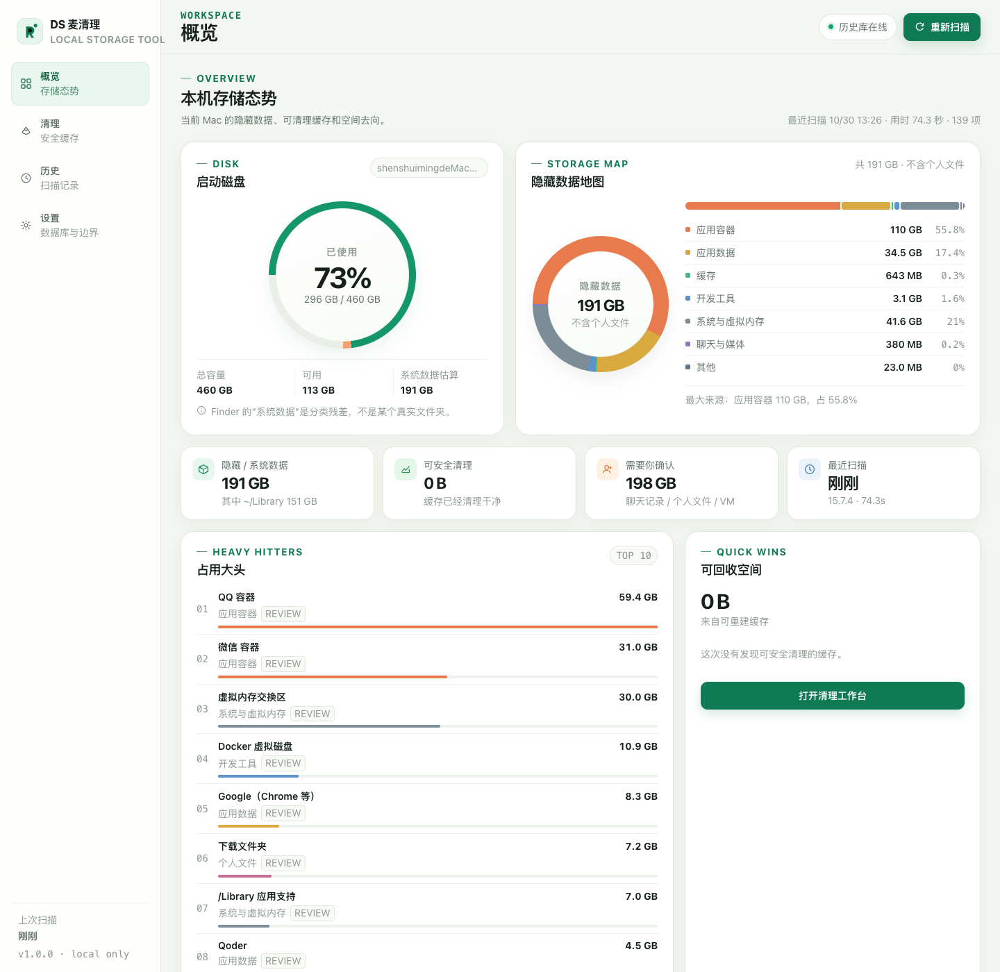

# 示例：一台 Mac 的「系统数据」解剖报告

> 这不是产品预设数据，而是 DS Mac Cleaner 的一次真实扫描样本。  
> 每次打开产品都会重新扫描，以当前机器为准。  
> 采集时间：2026-10-30 09:11（Asia/Shanghai）  
> 机器：MacBook Pro（Apple Silicon，macOS 15.7.4，启动盘 460 GiB）  
> 方法：DS Mac Cleaner 只读扫描 + `du -skx` + `df -k` + `tmutil listlocalsnapshots`。数字会随缓存和使用情况变化。

## 一句话结论

这台机器「系统数据」大，不是 macOS 本身胖，而是 **`~/Library` 里的应用容器和隐藏数据太重**：

- **QQ + 微信 = 108.8 GB**，占了全部隐藏数据的半壁江山；
- **应用容器总计 128.8 GB**，Finder 不会把它算进「文稿 / 应用」，只能落到「系统数据」；
- **用户缓存 26.8 GB**，其中 Yarn 一个就 14.8 GB；
- **应用支持 34.5 GB**（Chrome、Qoder、TRAE、VS Code、Steam……）；
- **虚拟内存交换区 28.0 GB**，由 macOS 管理，不是垃圾；
- **Docker 稀疏磁盘 10.8 GB**；Downloads 还有 10.9 GB 个人文件。

本次可安全清理的缓存是 **28.4 GB**，占可用空间的约 43%。真正的大头——聊天记录——必须用微信/QQ 自己的存储管理处理。



## 磁盘与隐藏数据

| 指标 | 实测 |
|---|---:|
| 启动盘容量 | 460 GiB |
| 已使用 | 345.7 GiB（85%） |
| 可用 | 65.5 GiB |
| 隐藏 / 系统数据估算 | **235 GB** |
| 其中 `~/Library` | **195 GB** |
| 可安全清理（白名单缓存） | **28.4 GB** |
| 需要人工确认 | **218 GB** |
| Time Machine 本地快照 | 0 个 |

> 「系统数据」是 Finder 的分类残差，不是某个叫 System Data 的目录。`df` 的 345.7 GiB 是卷级用量；235 GB 是本工具按隐藏数据来源做的可解释估算，两者口径不同。

## 200 GB 是怎么堆出来的

### 1. 应用容器：128.8 GB（最大来源）

沙盒应用的 `~/Library/Containers/<bundle-id>` 目录。Finder 不会把它归入「文稿」或「应用」，而 macOS 存储面板又无法细分，于是这些真实文件被统称为「系统数据」。

| 容器 | 占用 | 里面是什么 |
|---|---:|---|
| QQ | **59.2 GB** | `nt_data` 约 37 GB 聊天文件 + `nt_db` 约 20 GB 消息数据库 |
| 微信 | **49.6 GB** | `msg` 约 37 GB 图片/视频/文件 + `db_storage` 约 4.2 GB + `cache` 2.3 GB |
| Docker Desktop | 10.8 GB | 稀疏的 `Docker.raw`，逻辑上限 1 TB |
| 钉钉 | 3.1 GB | 本地消息与文件 |
| QQ 音乐 | 2.0 GB | 下载与缓存 |
| 企业微信 | 1.1 GB | 本地数据 |
| 其他（WPS、腾讯会议等） | 约 2.9 GB | 各自的应用数据 |

**关键判断：这 108.8 GB 不是可以直接删的「垃圾」。** 微信/QQ 内部有聊天记录、图片、视频、文件和账号状态；直接删容器等于重置应用，可能永久丢记录。

### 2. 应用支持：34.5 GB

`~/Library/Application Support` 里是应用的持久数据，不是缓存：

- Google（Chrome 配置、扩展、端侧模型）**8.2 GB**
- Qoder **4.5 GB**
- Qoder CN **3.6 GB**
- TRAE SOLO CN **3.4 GB**
- VS Code **3.2 GB**
- 微信开发者工具 **2.4 GB**
- Steam **1.3 GB**
- Quark **1.2 GB**
- 其余为 QClaw、Codex、输入法等

这些目录不能“一键清理”，否则会丢扩展、工作区状态或登录信息。

### 3. 缓存：26.8 GB（真正安全的回收区）

| 缓存 | 占用 | 能否安全删 |
|---|---:|---|
| Yarn `v6` | **14.8 GB** | ✅ 可重建，只是下次装包重新下载 |
| WorkBuddy 迁移缓存 | 2.4 GB | ✅ 可重建 |
| npm `_cacache` | 2.2 GB | ✅ 可重建 |
| Google 缓存 | 1.2 GB | ✅ 不含书签/密码/历史 |
| 各类 updater | 约 3.1 GB | ✅ 已下载的更新包 |
| TRAE / 微信开发者工具 / pnpm / Homebrew / Cypress / Playwright 等 | 约 5 GB | ✅ 可重建，部分需重新安装二进制 |

合计 **28.4 GB**，是本工具默认勾选的部分。

### 4. 虚拟内存：28.0 GB

`/System/Volumes/VM` 里是 macOS 的 swap 文件。它由内核按内存压力创建，重启后会按需收缩，**不是可以手动删除的缓存**。当前机器 28 GB 的 swap 说明系统曾长期处于较高内存压力；关掉不用的 Electron 应用、重启，比“删 swap”安全。

### 5. Docker：10.8 GB

Docker Desktop 的 `Docker.raw` 是稀疏文件：`ls` 可能显示 1 TB，实际占用 10.8 GB。不要直接删除这个文件。正确做法：

```bash
docker system df
docker system prune          # 未使用镜像 / 停止容器 / 构建缓存（不会删 volume）
docker builder prune
```

如果确实需要缩小虚拟磁盘，在 Docker Desktop → Settings → Resources → Disk image size 中处理，或备份后重置。

### 6. 其它隐藏项

- `/Library/Application Support` **7.0 GB**：系统级应用数据（驱动、Adobe、输入法等）
- `/private/var/folders` **3.0 GB**：系统临时文件，重启会清一部分
- `~/Library/Group Containers` **1.5 GB**
- `~/Library/Logs` **808 MB**（其中 DiagnosticReports 可安全清理）
- `~/Library/pnpm` **3.1 GB**：pnpm 内容仓库，已有项目可能硬链接引用，建议 `pnpm store prune`
- Downloads **10.9 GB**：个人文件，不属于系统数据

## 本机「系统数据」构成图

```text
应用容器       128.8 GB  ████████████████████████████  52.3%
应用数据        34.5 GB  ███████                        14.0%
缓存            26.8 GB  ██████                         10.9%
系统与虚拟内存  39.6 GB  ████████                       16.1%
开发工具         5.3 GB  █                             2.2%
聊天与媒体       0.4 GB                                    0.2%
个人文件        10.9 GB  ██                             4.4%
```

（图表含个人文件；概览页估算 235 GB 时不含 Downloads。）

## 推荐处理顺序

1. **先清 28.4 GB 安全缓存**：本工具默认全选，输入 `DELETE` 确认即可。核心是 Yarn 14.8 GB。
2. **处理微信 49.6 GB**：微信 → 设置 → 存储空间 → 按聊天/图片/视频/文件清理；先备份重要记录。
3. **处理 QQ 59.2 GB**：QQ → 设置 → 存储管理 → 清理聊天文件；不要动 `nt_db` 数据库。
4. **Docker 10.8 GB**：`docker system df` 查看后 `docker system prune`，不要去 Finder 删 `Docker.raw`。
5. **重启回收 swap**：让 28 GB 交换文件按需回落；同时清理 `/private/var/folders` 的一部分。
6. **整理 Downloads 10.9 GB**：这是个人文件，建议迁移到外置盘或云盘。

## 不要做的事

- ❌ 不要删除整个 `~/Library/Containers`、`~/Library/Application Support` 或 `~/Library/Caches`。
- ❌ 不要删微信 `msg/`、QQ `nt_db/` 或 `nt_data/`；这不是缓存。
- ❌ 不要删 `/System/Volumes/VM` 下的 swap 文件。
- ❌ 不要直接删 `Docker.raw`。
- ❌ 不要用来源不明的“一键清理”脚本处理 `~/Library`。

## 如何复现

```bash
cd ds-mac-cleaner
./scripts/start-server.sh
# 打开 http://127.0.0.1:8787，点「重新扫描」
```

扫描只读；报告保存到 `.runtime/latest_scan.json`，历史写入 Docker 中的 PostgreSQL。完整代码和安全边界见 [README](../README.md)。
